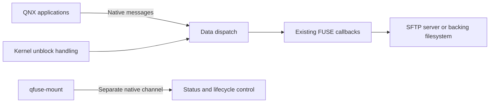

# QFuse

Mount a development folder on QNX, build on your computer, and run the result
from the target. QFuse runs a tested subset of high-level FUSE filesystems as
ordinary QNX 8.0 resource-manager processes, including SSHFS.

Waiting clients can be interrupted when a filesystem callback stalls. A separate
native control channel provides status and stop operations independently of the
mounted folder. The background launcher checks the process identity and instance
before sending management commands.

**Experimental, source-compatible subset of FUSE API 31.** Verified on QNX 8.0
x86_64 and aarch64le in QEMU, including four-processor runs on both. Mounting
requires root. See the
[supported profile](docs/guide/profile.md) before porting another application.

## Use it on QNX

After building and deploying the applications and their dependencies, configure
your target's OpenSSH client for key authentication and a pinned host key:

```sh
qfuse-mount sshfs -F /root/.ssh/laptop_config developer@laptop:/build-output /data/laptop
/data/laptop/hello
qfuse-mount status /data/laptop
qfuse-mount stop /data/laptop
```

The first command starts the filesystem in the background and waits for it to
be ready. Build new executables in the shared output folder on your development
computer; execute them directly from QNX. The optional
[local live-workflow lab](docs/guide/live-workflow.md) exports a scoped folder
without enabling a host SSH service.

When a callback or network operation stalls, an application can use signals or
QNX kernel timeouts to interrupt its wait. Filesystem code may still be running:
cancellation does not roll back writes or forcibly cancel third-party threads.
Namespace work on independent canonical paths can proceed while a callback is
stalled. Operations that overlap the affected path queue in arrival order, and
their client waits remain interruptible. Shared third-party locks or transports
can still block callbacks.
Use `qfuse-mount stop --force /data/laptop` for explicit process-level recovery.

## Build on a Linux SDK host

Requirements: your own activated QNX SDP 8.0; Bash, GNU make, a host C compiler,
Python 3 with venv/pip, patch, pkg-config, ninja, tar and xz. Downloads are pinned
and checked. The SDK and target runtime remain in your own installation.

```sh
# Portable callback checks, using the host compiler:
make check

# Select your licensed SDK and QNX target architecture:
export QNX_SDP_ROOT=/opt/qnx800
source "$QNX_SDP_ROOT/qnxsdp-env.sh"
export QFUSE_ARCH=x86_64       # or aarch64le
make install-sshfs
```

This builds real GLib/libffi, the library, applications and native probes in
user-owned directories. Source `scripts/target-config.sh` to inspect
`QFUSE_INSTALL_PREFIX` and the other configurable paths. The installed binaries
run on QNX; the static library and pkg-config metadata are for cross-compilation.
See [build and deployment](docs/guide/build.md) for native Linux and the optional
Mac/container arrangement.

For a first build without SSHFS or the local lab, follow the
[independent reproduction guide](docs/guide/reproduce.md): build, mount hello,
read its file, and stop it using your own SDK and target.

## What is verified

- SSHFS reads and writes over authenticated SFTP, with host-key rejection and
  persistence after remount.
- 51 named native-versus-mounted syscall cases compare semantic results, exact
  errno and deterministic content/metadata.
- A 5,000-file native copy/diff, executable loading, handle lifetime,
  permissions, concurrent clients and process-death recovery.
- Held-callback tests cover unrelated directory access, priority-50 clients,
  signal/kernel-timeout interruption, descriptor close/exit and late replies.
- Saturation tests fill the admitted request budget and check timeout handling.
- Clean-clone rebuilds in separate Ubuntu userlands on the same owner's host.
  Independent developer reproduction is [requested separately](https://github.com/gowtham0992/qfuse/issues/1).

[Verification and evidence](docs/guide/verification.md) distinguishes native
execution from host-only checks and lists the exact qualifications.

## How it works

Each filesystem links against `libfuse3.a`. Native QNX connect/I/O messages map
to its callbacks, with authenticated caller identities and permission checks.
Callbacks can run concurrently on different files. A per-file operation lock
serializes open, stat and I/O on that file. Short state critical sections protect
SDK attributes and namespace bookkeeping. Queued path leases protect namespace
transactions, including atomic source/destination reservation for rename. The
dispatcher releases state locks around foreign callbacks. Deferred release runs outside the request's reply lifetime.



The data dispatch, cancellation monitor, deferred cleanup and administration
channel belong to the filesystem process. There is no shared QFuse daemon or
additional FUSE kernel module. [Architecture](docs/guide/architecture.md) explains
locking, ownership, limits and failure behavior.

## Compatibility and contribution

Upstream hello and passthrough sources build unchanged. Passthrough selects the
explicit optional `qfuse-dirent` adapter for QNX directory-entry conversion.
SSHFS 3.7.3 has one preprocessor-guard change for the absent Linux transport FD.
The optional bindfs 1.18.4 port mounts a permission-transformed view with the
directory adapter and one QNX directory-open flag patch.
These are tested compatibility baselines, not a claim that every FUSE program
or mount option works.

The [porting guide](docs/guide/porting.md) explains how to evaluate another
filesystem. The [qnx-ports recipe](integration/qnx-ports/qfuse) is proposed in
[upstream PR #334](https://github.com/qnx-ports/build-files/pull/334); acceptance
is pending. Upstream source is fetched by pinned URL; this repository contains
the porting layer and build work, not upstream Git history.

Original QFuse code is MIT. Upstream components retain their own licenses; see
[THIRD_PARTY.md](THIRD_PARTY.md). Public distributions contain source and build
instructions, excluding SDKs, licenses, target images, keys and credentials.
