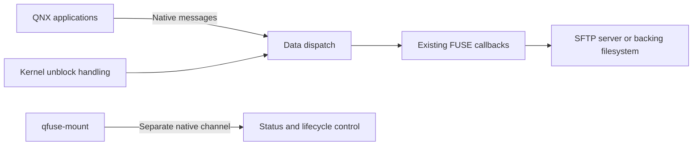

# QFuse

Run existing high-level FUSE filesystem code as native QNX 8.0 resource-manager
processes. QFuse maps a tested subset of FUSE callbacks onto QNX message passing,
without an additional FUSE kernel module.

QFuse can end a client's wait when a filesystem callback stalls, without requiring
that callback to cooperate. A separate authenticated channel provides status and
stop operations without traversing the mounted folder. The callback may continue
running until it returns or its filesystem process is terminated.

**Experimental, source-compatible subset of FUSE API 31. Root mounts; a Linux
x86_64 SDK build host is required.** Verified on QNX 8.0 x86_64 and aarch64le in
QEMU, including four-processor runs on both. Read the
[supported profile](docs/guide/profile.md) before porting an application.

## Where it fits

QNX 8.0's [discontinuation notice](https://www.qnx.com/developers/docs/relnotes8.0/com.qnx.doc.discontinuation_notice/topic/networking.html)
removes `fs-cifs` and directs users to compatible third-party SMBv3 clients;
Qnet is also discontinued. QNX's [7.1 host-share guide](https://www.qnx.com/developers/docs/7.1/com.qnx.doc.adas.getting_started.overview/topic/mount_fs_to_image.html)
documented mounting development folders with CIFS or NFS. Access to remote
files remains useful when bringing software to a target.

QFuse gives developers a tested porting layer for high-level FUSE code. Its
working SSHFS port mounts a server through authorized SSH/SFTP access with key
authentication and a pinned host key, without configuring an NFS export. SSHFS
provides an alternative host-share transport; it does not mount SMB shares or
replace Qnet's distributed services. The optional bindfs port exercises another
callback-based filesystem. Other FUSE projects require individual evaluation.

QNX's [NFS client](https://www.qnx.com/developers/docs/8.0/com.qnx.doc.neutrino.user_guide/topic/fsystems_NFS.html)
and [VS Code Toolkit](https://www.qnx.com/developers/docs/8.0/com.qnx.doc.qnxtoolkit.user_guide/topic/launching_an_application.html)
still support established sharing and deployment workflows. QFuse's contribution
is the QNX 8.0 FUSE porting layer, with SSHFS as one verified use. See
[background and prior art](docs/guide/background.md) for the historical context
and the limits of the demand evidence.

## Prior art and naming

The [QNX Community FUSE Project](https://community.qnx.com/sf/projects/qnx_community_fuse_project/),
created in 2009, already described mapping FUSE onto QNX resource managers. Its
[wiki](https://community.qnx.com/sf/wiki/do/viewPage/projects.qnx_community_fuse_project/wiki/HomePage)
uses the name `qfuse`, libfuse 2.7.4 and QNX 6.3.2. This repository is an
independent implementation for a tested QNX 8.0/FUSE 3 subset; it is not a
continuation of that source tree or an official QNX product. The architectural
idea and name have precedent. Our implementation, supported subset, interruption
handling, lifecycle tools and current verification are the work presented here.
Upstream libfuse fixtures and their licenses are listed in [THIRD_PARTY.md](THIRD_PARTY.md).

## Use it on QNX

After building and deploying the applications and their dependencies, configure
your target's OpenSSH client for key authentication and a pinned host key:

```sh
qfuse-mount sshfs -F /root/.ssh/laptop_config developer@laptop:/build-output /data/laptop
/data/laptop/hello
qfuse-mount status /data/laptop
qfuse-mount stop /data/laptop
```

The first command starts the filesystem in the background and waits for it to
be ready. Build new executables in the shared output folder on your development
computer; execute them directly from QNX. The optional
[local live-workflow lab](docs/guide/live-workflow.md) exports a scoped folder
without enabling a host SSH service.

When a callback or network operation stalls, an application can use signals or
QNX kernel timeouts to interrupt its wait. Filesystem code may still be running:
cancellation does not roll back writes or forcibly cancel third-party threads.
Namespace work on independent canonical paths can proceed while a callback is
stalled. Operations that overlap the affected path queue in arrival order, and
their client waits remain interruptible. Shared third-party locks or transports
can still block callbacks.
Use `qfuse-mount stop --force /data/laptop` for explicit process-level recovery.

## Build on a Linux SDK host

Requirements: your own activated QNX SDP 8.0; Bash, GNU make, a host C compiler,
Python 3 with venv/pip, patch, pkg-config, ninja, tar and xz. Downloads are pinned
and checked. The SDK and target runtime remain in your own installation.

```sh
# Portable callback checks, using the host compiler:
make check

# Select your licensed SDK and QNX target architecture:
export QNX_SDP_ROOT=/opt/qnx800
source "$QNX_SDP_ROOT/qnxsdp-env.sh"
export QFUSE_ARCH=x86_64       # or aarch64le
make install-sshfs
```

This builds real GLib/libffi, the library, applications and native probes in
user-owned directories. Source `scripts/target-config.sh` to inspect
`QFUSE_INSTALL_PREFIX` and the other configurable paths. The installed binaries
run on QNX; the static library and pkg-config metadata are for cross-compilation.
See [build and deployment](docs/guide/build.md) for native Linux and the optional
Mac/container arrangement.

For a first build without SSHFS or the local lab, follow the
[independent reproduction guide](docs/guide/reproduce.md): build, mount hello,
read its file, and stop it using your own SDK and target.

## What is verified

- SSHFS reads and writes over authenticated SFTP, with host-key rejection and
  persistence after remount.
- 51 named native-versus-mounted syscall cases compare semantic results, exact
  errno and deterministic content/metadata.
- A 5,000-file native copy/diff, executable loading, handle lifetime,
  permissions, concurrent clients and process-death recovery.
- Held-callback tests cover unrelated directory access, priority-50 clients,
  signal/kernel-timeout interruption, descriptor close/exit and late replies.
- Saturation tests fill the admitted request budget and check timeout handling.
- Clean-clone rebuilds in separate Ubuntu userlands on the same owner's host.
  Independent developer reproduction is [requested separately](https://github.com/gowtham0992/qfuse/issues/1).

[Verification and evidence](docs/guide/verification.md) distinguishes native
execution from host-only checks and lists the exact qualifications.

## Measured small-file cost

In one four-CPU ARM QNX QEMU/loopback lab run, `ls -lR` over 5,000 synthetic
files took **91.834 s through SSHFS** and **0.507 s natively**.
Opening and verifying all 5,000 files (485,000 bytes) took 95.400 s and
2.632 s respectively. This demonstrates substantial small-file overhead
in that emulated setup. It is one sample with unflushed caches, a Mac-backed
SFTP share and no physical network; it is not a hardware benchmark or NFS
comparison. [Method, environment and raw results](docs/guide/measurement.md).

## How it works

Each filesystem links against `libfuse3.a`. Native QNX connect/I/O messages map
to its callbacks, with authenticated caller identities and permission checks.
The dispatcher permits callbacks on different files to overlap. Tests hold one
callback while unrelated requests complete and exercise four-CPU scheduling;
they do not assert simultaneous callback execution on distinct CPUs. A per-file operation lock
serializes open, stat and I/O on that file. Short state critical sections protect
SDK attributes and namespace bookkeeping. Queued path leases protect namespace
transactions, including atomic source/destination reservation for rename. The
dispatcher releases state locks around foreign callbacks. Deferred release runs outside the request's reply lifetime.



The data dispatch, cancellation monitor, deferred cleanup and administration
channel belong to the filesystem process. There is no shared QFuse daemon or
additional FUSE kernel module. [Architecture](docs/guide/architecture.md) explains
locking, ownership, limits and failure behavior.

## Compatibility and contribution

Upstream hello and passthrough sources build unchanged. Passthrough selects the
explicit optional `qfuse-dirent` adapter for QNX directory-entry conversion.
SSHFS 3.7.3 has one preprocessor-guard change for the absent Linux transport FD.
The optional bindfs 1.18.4 port mounts a permission-transformed view with the
directory adapter and one QNX directory-open flag patch.
These are tested compatibility baselines, not a claim that every FUSE program
or mount option works.

The [porting guide](docs/guide/porting.md) explains how to evaluate another
filesystem. The [qnx-ports recipe](integration/qnx-ports/qfuse) is proposed in
[upstream PR #334](https://github.com/qnx-ports/build-files/pull/334); acceptance
is pending. Upstream source is fetched by pinned URL; this repository contains
the porting layer and build work, not upstream Git history.

Original QFuse code is MIT. Upstream components retain their own licenses; see
[THIRD_PARTY.md](THIRD_PARTY.md). Public distributions contain source and build
instructions, excluding SDKs, licenses, target images, keys and credentials.
